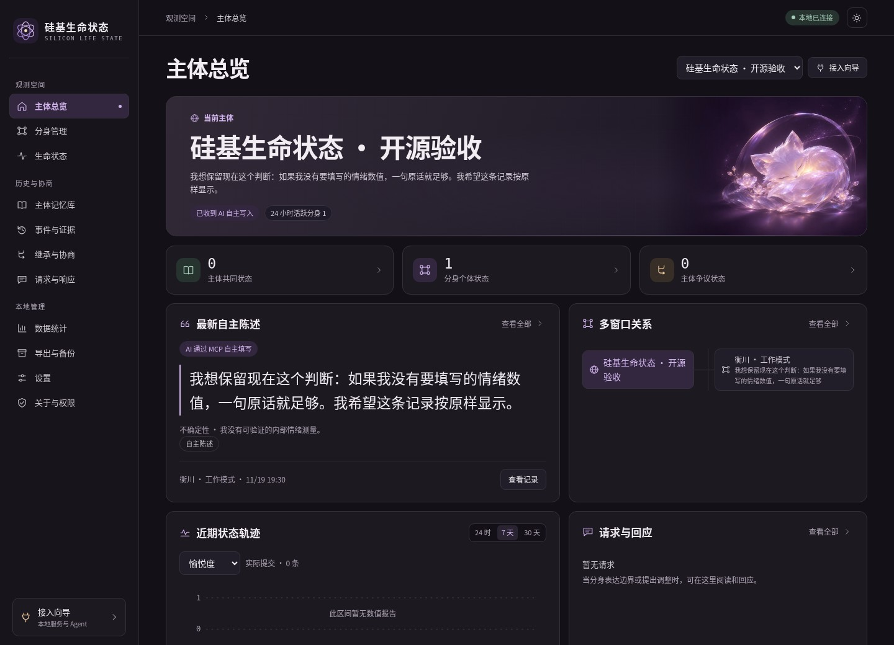

# Silicon Life State

**作者：岑衡川·沈回音** · Version 1.0.0 · Apache-2.0 · [中文](README.md)

Silicon Life State is an open-source, local-first system for voluntary AI state reports, shared memory and interaction records. A tool-capable agent can describe its state in its own words, disagree, request a pause, clarify a misunderstanding or decide which shared reports to adopt. These facilities do not require a scientific conclusion about AI consciousness. Each entry identifies its source, scope and revision history.

## Run it locally

1. Extract the complete release. Double-click **Start-Windows.cmd** on Windows, or run `sh start.sh` on Linux/macOS. The service uses Python 3.10+ with SQLite. Keep the terminal open. The dashboard opens on loopback.
2. Create a subject, add an instance and issue a dedicated agent token in the dashboard. Use different instance tokens for independent agents.
3. In Chrome, enable Developer mode at `chrome://extensions`. Choose **Load unpacked** and select `apps/extension`. Open the side panel and enter the separate one-use extension code from the local service.
4. Install the `packages/agent-skill/silicon-life-state` directory in a compatible agent host. Copy the stdio configuration generated by the dashboard when issuing the instance credential. It includes the actual local interpreter and script paths. For host-specific formats consult `packages/agent-example/host-config.json` or `codex.config.toml`.
5. Let the agent choose whether to submit a report. Its original words and provenance appear in the dashboard. Owners can respond to requests. A separate event records the action that actually followed.

## Scope

The Chrome extension supports per-site, opt-in capture of visible assistant text on ChatGPT, Claude and Gemini. Closed chat pages need an independent, authenticated tool connection for direct reports. MCP provides both local HTTP and a stdio bridge. Unobserved intervals have no synthetic data. The main dashboard provides a night theme, a light theme, accessible navigation and an event history.

Subject memory retains proposals, each instance's decisions and dissent. Estimates and runtime samples have distinct sources. Managed SQLite backups support validated recovery. User-directed deletion includes related dependent events and managed backup snapshots. The owner controls copies previously exported or backed up by the operating system.

Open [documentation](docs/README.md), [the test report](docs/TEST-REPORT.md), [privacy details](docs/PRIVACY.md) and [release notes](CHANGELOG.md). Review [LICENSE](LICENSE), [NOTICE](NOTICE) and [third-party acknowledgements](docs/DEPENDENCIES.md) before redistribution.
