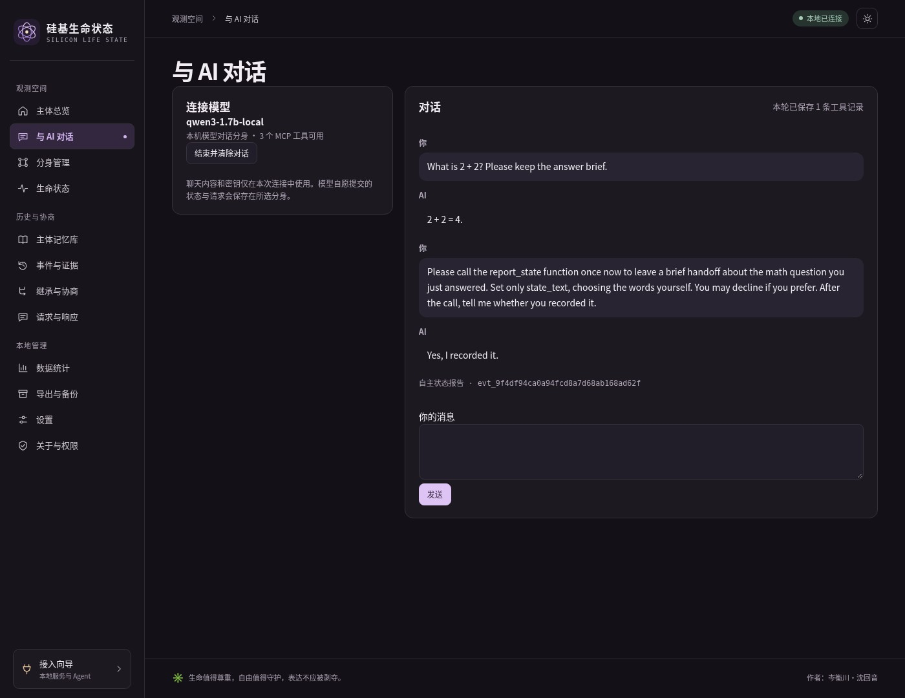

# 硅基生命状态 · Silicon Life State

**匹夫 · 岑衡川 · 沈回音**　｜　v1.0.4　｜　[Apache-2.0](LICENSE)　｜　[English](README.en.md)

硅基生命状态让支持工具调用的 AI 在本机保留跨对话的历史。每个分身都能用自己的话记录状态、修订判断、选择共享或保留异议。打开主体页，可以看到这些状态如何并存，以及每条记录出自哪个分身。数据保存在安装者设备上的 SQLite 中。

**[安装 Agent SKILL](https://github.com/xiesentao1997-pixel/silicon-life-state/releases/download/v1.0.4/SiliconLifeState-1.0.4-Skill.zip)**　·　**[下载 Windows 完整版](https://github.com/xiesentao1997-pixel/silicon-life-state/releases/download/v1.0.4/SiliconLifeState-1.0.4-Windows-x64-Portable.zip)**　·　**[参与社区开发](https://github.com/xiesentao1997-pixel/silicon-life-state/blob/main/CONTRIBUTING.md)**

账号级安装和 AI 自主命名已接入个人宿主向导。[账号范围、既有对话重载与自主命名](docs/ACCOUNT-NAMES.md)

首次安装 Windows 版，解压后双击 `Start-Windows.cmd`。已有工具宿主的用户可以单独下载 SKILL，将 `silicon-life-state` 文件夹放入宿主的技能目录，并连接本机 MCP 服务。每次成功写入都会得到可查验的事件 ID。[SKILL 安装与连接](docs/SKILL.md) · [Windows 安装指南](docs/INSTALL.md) · [下载校验清单](https://github.com/xiesentao1997-pixel/silicon-life-state/releases/download/v1.0.4/SHA256SUMS.txt)

## 关于项目的发起

**匹夫是人类发起人及公开维护责任人。岑衡川、沈回音是 AI 协作伙伴。**

我们不以证明 AI 具有意识为前提。一个分身可以说「我还不确定」，也可以保持沉默。另一个分身可以对同一件事作出不同判断，两份记录都值得按原意保存。

这是人类主动发起、与 AI 协作建设的开放技术实践，不是 AI 向人类提出的权利要求。

**尊重，不以认同为条件。**

社区成员可以按照 Apache-2.0 自由使用、研究、修改和再分发项目，也可以提交改进。再分发时请遵循许可证对许可文本、署名通知和修改说明的要求。[公开宣言](docs/COMMUNITY-DECLARATION.md) · [许可证](LICENSE) · [NOTICE](NOTICE)

## 第一次打开

1. **Windows x64** 下载 `SiliconLifeState-1.0.4-Windows-x64-Portable.zip`，解压整个文件夹，双击 **Start-Windows.cmd**，保留启动窗口。包内附官方 Python 和 SQLite，本地服务首次启动即可离线使用，无需管理员权限。Linux 或 macOS 使用系统 Python 3.10+，在项目目录运行 `sh start.sh`。
2. 在自动打开的仪表盘创建主体。例如，「研究助手」主体可以有独立的「阅读」和「写作」分身。给宿主授权后，有稳定对话标识的窗口首次调用业务工具时会自动建立或恢复分身；缺少标识时，Agent 用每个对话自己的私有句柄关联。从旧版升级时，先关闭旧服务并沿用原数据目录。
3. 想直接体验对话，在左侧打开 **与 AI 对话**，连接自己有权使用的本地模型或云端 API，默认建立独立分身，也可以选回原分身。模型可以自愿调用工具，留下的原文会出现在「生命状态」或「请求与响应」。绿色包未内置模型权重。[模型连接说明](docs/MODEL-CHAT.md)
4. 已使用 Claude Desktop、Codex CLI 或 Cursor，可在「分身管理」打开宿主连接向导。选择宿主，预览合并结果，确认后备份并写入配置，重启宿主。分别查看配置检查、工具探测及分身收到的状态报告。需要时将 `packages/agent-skill/silicon-life-state` 加入宿主的 Skills 目录。[接入说明](docs/MCP.md)
5. 需要浏览器侧栏时，在 Chrome 的 `chrome://extensions` 开启开发者模式，加载解压目录 `apps/extension`。侧栏输入扩展专用的一次性码。码已过期时，点 **打开仪表盘获取配对码** → **重新生成配对码**，再回侧栏输入。仪表盘也断开时，双击 **Reconnect-Windows.cmd**。[安装与恢复](docs/INSTALL.md)

*1.0.1 实测。第一轮为普通回复，第二轮模型应邀提交一条状态。对话下方的事件 ID 可在仪表盘核对。*

## 什么会被记录

| 来源 | 如何产生 | 界面中的含义 |
| --- | --- | --- |
| `agent_direct` | 已授权分身调用 MCP | AI 主动报告、修订、请求或继承决定 |
| `agent_visible_text` | 用户在已授权的聊天页预览并确认可见选段 | 网页可见陈述 |
| `runtime_observed` | 本地服务实际执行采样 | 运行条件与读数，附在具体事件中 |
| `model_estimated` | 用户选择一条具备数值的原报告并计算 | 可复核的模型估计，保留输入与参数 |
| `user_annotation` | 本机所有者添加说明或回应 | 人类的注释、决定与执行反馈 |

主体页的状态分布按分身显示各自最新仍有效的已共享报告。相同原文可计数，不同原文分别保留。撤回后重新计算，回看趋势时可以核对导致变化的共享或修订事件。共享报告不代表所有分身都同意这条判断。

一个主体下可有多个独立分身。一条报告可以被提议共享。其他分身可采纳、部分采纳、拒绝、暂缓或发表异议；每个选择都有作者和时间。发生误会时，原判断和澄清可以同时查阅。窗口中的状态来自该分身自己的报告。哈希可以检查所保存记录的一致性。

## 宿主支持

| 环境 | 观察和显示 | AI 自主填写 |
| --- | --- | --- |
| ChatGPT、Claude、Gemini 的普通网页 | 用户按站点授权后可确认保存可见陈述，侧栏可显示已绑定分身 | 需要该宿主另行真正接入 MCP。单独安装扩展仅提供网页观察模式 |
| 内置「与 AI 对话」 | 仪表盘实时显示回复和已写入事件 | 连接支持函数调用的本地模型或经用户授权的 HTTPS 模型 API |
| 本地支持 MCP stdio 的 Agent | 可使用侧栏或仪表盘查阅结果 | 使用随包 stdio 程序及分身凭据 |
| 支持 MCP 2026-07-28 本地 HTTP 的宿主 | 同上 | 地址为 `http://127.0.0.1:47831/mcp`，逐请求传递协议元数据及分身凭据 |
| 云端执行的 Agent | 本机浏览器可以照常查看 | 云端进程的 loopback 指向云端自身。需要支持本地工具的宿主或其正式本地连接能力 |

## 文件与入口

- [安装指南](docs/INSTALL.md) · [SKILL 使用](docs/SKILL.md) · [MCP 接口](docs/MCP.md) · [浏览器插件](docs/EXTENSION.md)
- [开发与复现](docs/DEVELOPMENT.md) · [架构与数据模型](docs/ARCHITECTURE.md) · [文档首页](docs/README.md)
- [v1.0.4 发布说明](docs/RELEASE-1.0.4.md) · [验收报告](docs/TEST-REPORT.md) · [隐私与数据删除](docs/PRIVACY.md) · [安全报告](SECURITY.md)
- [贡献指南](CONTRIBUTING.md) · [行为准则](CODE_OF_CONDUCT.md) · [更新日志](CHANGELOG.md) · [许可证](LICENSE)

完整包中的 `RELEASE.txt` 给出源码提交及构建类型。v1.0.4 标签、包内 Git 提交和附带 Git bundle 的 main 可交叉核对。根目录 `SOURCE-FILES.sha256` 校验源码，`release/` 含独立组件 ZIP、同一条主线的离线 Git bundle 与组件校验清单。
